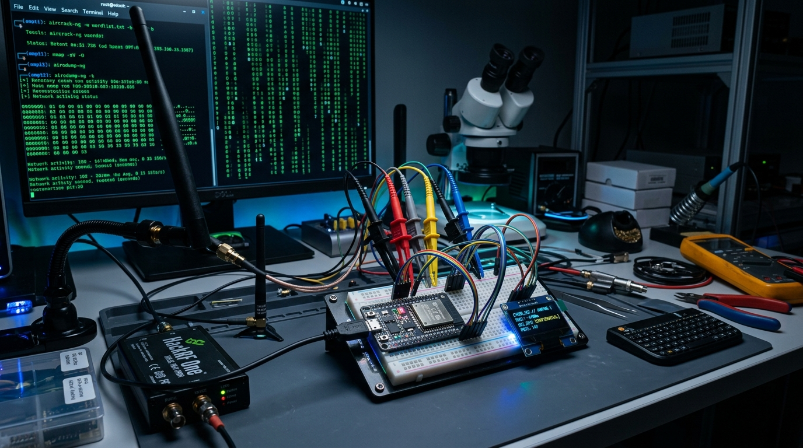

---
tags:
  - utilidades
  - tecnologia
  - esp32
  - ciberseguridad
  - hardware-hacking
  - red-team
  - rf
  - electronica
---

# ⚡ 50 Proyectos asombrosos con un ESP32 de 4$: Ciberseguridad, Red Teaming, RF y Hardware Hacking



El microcontrolador **ESP32** revolucionó el prototipado electrónico por su ridículo coste (apenas 3 a 5 euros) y su descomunal potencia: procesador dual-core a 240 MHz, radios Wi-Fi y Bluetooth/BLE integradas, timers de hardware de ultraprecisión y puertos USB nativos en sus variantes S2/S3. 

En un viral y aclamado hilo técnico publicado por la investigadora de seguridad **Zoë** ([@zoecyber001 en X](https://x.com/zoecyber001/status/2109348811089088956)), se recopila una enciclopedia práctica con **50 proyectos reales** capaces de convertir este diminuto microcontrolador en herramientas avanzadas de auditoría física, pentesting inalámbrico, comunicaciones fuera de red (*off-grid*) y análisis de hardware.

A continuación se detalla la guía exhaustiva con los 50 proyectos organizados en sus 5 bloques fundamentales, explicando el protocolo y el principio técnico que hace posible cada uno.

> ⚠️ **Aviso de Responsabilidad Ética**: Todas las herramientas y técnicas descritas en este documento tienen fines exclusivamente educativos, de investigación en seguridad y para ejercicios de *Red Teaming* / auditoría con autorización expresa por escrito.

---

## 🧭 Bloque 1: Rastreo, Radar y Control de Acceso Físico (1–10)

Esta categoría explora cómo exprimir las capas físicas de radio y protocolos industriales para vigilar perímetros, monitorizar accesos y vulnerar lectores de tarjetas.

```
       [ Ondas Wi-Fi ]  ──►  (Reflexión en cuerpos)  ──►  [ ESP32 CSI: Detección a través de paredes ]
  [ Lector Wiegand ]  ──►  [ ESPKey Intercept ]    ──►  [ Apertura remota BLE / Exfiltración ]
```

### 1. Radar Wi-Fi mediante CSI (ESP-CSI)
* **Principio técnico**: Analiza la *Channel State Information* (CSI) de las señales Wi-Fi 802.11n/ac. Las fluctuaciones electromagnéticas rebotan en los cuerpos humanos.
* **Capacidad**: Rastrea movimientos e incluso detecta la frecuencia respiratoria de personas situadas al otro lado de paredes sólidas sin usar cámaras.

### 2. Estación Terrena de Satélites (TinyGS)
* **Principio técnico**: Al conectar un módulo LoRa (SX1262 / SX1276) al ESP32 y sintonizar frecuencias UHF (433/868/915 MHz), forma una estación terrestre distribuida.
* **Capacidad**: Recibe telemetría en tiempo real de satélites cubesat y picosatélites en órbita baja (LEO) a más de 500 km de altitud.

### 3. Rastreador GPS Mundial Gratuito (OpenHaystack)
* **Principio técnico**: Implementa el protocolo criptográfico BLE de la red *Find My* (Buscar) de Apple emitiendo balizas rotatorias.
* **Capacidad**: Localización mundial de cualquier objeto sin tarjeta SIM ni pagar cuotas mensuales, aprovechando los millones de iPhones que actúan como repetidores pasivos.

### 4. Interceptor de Lectores de Acceso (ESPKey / Wiegand Tap)
* **Principio técnico**: Se conecta físicamente en paralelo a las líneas Data0/Data1 del protocolo Wiegand detrás de lectores RFID de pared.
* **Capacidad**: Roba los identificadores de tarjetas de empleados al pasar y permite inyectar aperturas de puerta bajo demanda mediante una interfaz Bluetooth.

### 5. Emulador de Banda Magnética (MagSpoof)
* **Principio técnico**: Controla un pequeño electroimán (o bobina inductiva) pulsando campos electromagnéticos variables que simulan el desplazamiento físico de una banda magnética tradicional.
* **Capacidad**: Engaña a los lectores de tarjetas magnéticas de terminales de punto de venta (TPV) o cerraduras sin necesidad de contacto físico.

### 6. Replay Sub-GHz para Puertas y Barreras
* **Principio técnico**: Acoplado a un transceptor CC1101, digitaliza transmisiones de modulación ASK/OOK en bandas libres (315 MHz / 433 MHz).
* **Capacidad**: Graba y reproduce la señal de mandos de garaje y barreras vehiculares de código fijo para abrir accesos sin el mando original.

### 7. Micrófono Espía Encubierto (Covert Audio Bug)
* **Principio técnico**: Toma audio digital de alta fidelidad desde un micrófono I2S (como el INMP441) y lo codifica en un stream de audio cifrado.
* **Capacidad**: Transmisión de sonido ambiental en tiempo real sobre Wi-Fi local oculto en una cápsula más pequeña que una moneda de 2 euros.

### 8. Sniffer Pasivo de Tráfico Peatonal (Probe Requests)
* **Principio técnico**: Pone la tarjeta de red en modo promiscuo monitorizando tramas *Probe Request* que los smartphones emiten continuamente buscando redes conocidas.
* **Capacidad**: Permite estimar la afluencia, contar asistentes únicos, medir tiempos de permanencia y trazar mapas de calor de presencia.

### 9. Bypass de Relés de Ascensor (Elevator Override)
* **Principio técnico**: Módulo de relés optoacoplados gobernado por ESP32 intercalado en la botonera de maniobra del ascensor.
* **Capacidad**: Cierra contactos secos para habilitar plantas restringidas o de acceso privado sin requerir llave física ni tarjeta de proximidad.

### 10. Clonador NFC/RFID de Alta Frecuencia (13.56 MHz)
* **Principio técnico**: Mediante un chip PN532 o RC522 por SPI/I2C, interactúa con tarjetas Mifare Classic e ISO 14443A.
* **Capacidad**: Lee credenciales, extrae sectores no protegidos y clona el UID en tarjetas vírgenes *Magic UID* al instante.

---

## 🚗 Bloque 2: Automoción y Bypasses de Hardware (11–20)

El ESP32 incorpora internamente periféricos industriales (como controlador CAN/TWAI y generadores de reloj ultraprecisos) capaces de interactuar con buses vehiculares y chips protegidos.

```
  [ Puerto OBD-II ]  ──►  [ Transceptor CAN / TWAI ]  ──►  [ ESP32 ]  ──►  Control de seguros / Claxon / RPM
  [ Pin VDD / Reset ] ──► [ Timer HW ESP32 (Glitch) ] ──► [ Chip Target ] (Bypass Secure Boot en nanosegundos)
```

### 11. Inyección en Redes de Vehículos (TWAI / CAN Bus)
* **Principio técnico**: Utiliza el controlador TWAI (*Two-Wire Automotive Interface*, compatible con CAN 2.0B) nativo del ESP32 junto con un transceptor SN65HVD230 conectado al puerto OBD-II.
* **Capacidad**: Inyecta tramas de control para desbloquear puertas, bajar ventanillas o manipular módulos del chasis.

### 12. Secuestrador de Cuadro de Instrumentos Digital
* **Principio técnico**: Spoofer de mensajes periódicos del bus CAN que sobrescribe los identificadores del cuadro de mandos (*cluster*).
* **Capacidad**: Altera la velocidad indicada, falsea las revoluciones por minuto (RPM) o enciende testigos de avería en la pantalla del coche.

### 13. Telemetría Inalámbrica en Tiempo Real (OBD Logger)
* **Principio técnico**: Solicita PIDs estándar OBD-II por bus CAN y publica las respuestas vía servidor WebSocket local en el ESP32.
* **Capacidad**: Visualización en tiempo real desde el móvil de temperatura de refrigerante, presión de admisión, consumo y códigos de error DTC mientras se conduce.

### 14. Activador Remoto de Claxon y Luces
* **Principio técnico**: Envía tramas dirigidas a la BCM (*Body Control Module*) del vehículo mediante conexión inalámbrica Wi-Fi/BLE.
* **Capacidad**: Hace sonar el claxon o activa ráfagas de luces largas de forma remota para localización o distracción táctica.

### 15. Sniffer de Apertura Sin Llave (Keyless Sniffer)
* **Principio técnico**: Sintoniza con un módulo de radiofrecuencia para registrar transmisiones de radio de mandos vehiculares antiguos.
* **Capacidad**: Captura códigos no cifrados de apertura en vehículos que aún no implementan *rolling code* (código dinámico).

### 16. Lector de Memorias SPI Flash en Placa (In-Circuit Dumper)
* **Principio técnico**: Conecta pinzas Pomona SOIC-8 a chips flash SPI (memorias serie 25xxx) manteniendo al microcontrolador anfitrión en Reset.
* **Capacidad**: Vuelca el firmware completo y particiones de configuración de dispositivos IoT sin necesidad de desoldar el chip.

### 17. Generador de Fallos de Alta Precisión (Power Glitcher)
* **Principio técnico**: Los temporizadores por hardware del ESP32 generan pulsos ultracortos (escala de decenas de nanosegundos) controlando un transistor MOSFET en la línea de alimentación.
* **Capacidad**: Provoca saltos en instrucciones de lectura de bits de protección para saltarse el *Secure Boot* o la protección contra lectura (RDP) de microcontroladores ARM/AVR.

### 18. Inhibidor de Cerraduras Inteligentes (2.4 GHz DoS)
* **Principio técnico**: Inundación continua de paquetes RF o tramas de conexión en la banda de 2.4 GHz en canales específicos de Zigbee o Wi-Fi.
* **Capacidad**: Fuerza a cerraduras electrónicas a entrar en modo seguro fuera de línea (*fail-secure* / *fail-safe*) impidiendo su apertura telemática.

### 19. Monitor Encubierto de Interruptores Antisabotaje (*Tamper*)
* **Principio técnico**: Monitoreo de microinterruptores de caja mediante interrupciones de pines GPIO de muy bajo consumo.
* **Capacidad**: Registra con marca temporal exacta y envía alerta inalámbrica instantánea si una carcasa o armario de seguridad física ha sido abierto.

### 20. Silenciador de Sirenas de Alarma Inalámbricas
* **Principio técnico**: Transmisión de comandos de desarmado o tramas de colisión continua en la frecuencia de sincronismo de la sirena (habitualmente 433.92 MHz).
* **Capacidad**: Neutraliza o silencia sirenas de alarmas domésticas antes de que emitan la señal acústica de intrusión.

---

## 📡 Bloque 3: Explotación Inalámbrica y Radiofrecuencia (RF) (21–30)

El núcleo RF del ESP32 permite operar en modo monitor, inyectar tramas crudas 802.11 y manipular balizas Bluetooth a nivel de bits.

```
       [ ESP32 ]  ──►  [ Tramas BLE Masivas ]      ──►  [ Congelación de iPhones / Androids ]
       [ ESP32 ]  ──►  [ Deauth 802.11 Management ] ──►  [ Captura WPA2 4-Way Handshake / PMKID ]
       [ Pin DAC/GPIO ] ──► [ Hilo de cobre (Antena) ] ──► [ Emisión FM comercial (88–108 MHz) ]
```

### 21. Colapsador de Dispositivos BLE (SourApple / BLE Spam)
* **Principio técnico**: Emite ráfagas continuas de paquetes de publicidad BLE (*Advertising packets*) simulando accesorios legítimos de Apple, Google Fast Pair o Swift Pair.
* **Capacidad**: Satura la interfaz de iPhones y smartphones cercanos, bloqueando la pantalla con avisos infinitos de vinculación y provocando congelaciones del sistema.

### 22. Capturador de Handshakes Wi-Fi (ESP32 Marauder)
* **Principio técnico**: Escucha pasivamente en canales 2.4 GHz las tramas de autenticación EAPOL de 4 vías (*4-way handshake*) y paquetes PMKID.
* **Capacidad**: Captura las credenciales de cifrado WPA2/WPA3 sin necesidad de conectarse al router, guardándolas en tarjeta microSD en formato `.pcap` para su análisis con Hashcat.

### 23. Portal Cautivo Pícaro (Evil Portal / Rogue AP)
* **Principio técnico**: Levanta un punto de acceso Wi-Fi abierto con servidor DNS comodín (*Captive DNS*) y servidor web HTTP embebido.
* **Capacidad**: Redirige automáticamente todo el tráfico a páginas idénticas de inicio de sesión de routers o redes públicas para capturar credenciales de usuarios confiados.

### 24. Herramienta de Desautenticación Wi-Fi (Deauther)
* **Principio técnico**: Envía tramas de gestión 802.11 de desautenticación con la dirección MAC del router falsificada hacia los clientes conectados.
* **Capacidad**: Expulsa a dispositivos de su red inalámbrica en cuestión de segundos, forzando su reconexión para interceptar el handshake.

### 25. Clonador Automático de Redes Conocidas (Karma AP)
* **Principio técnico**: Escucha las peticiones de búsqueda de redes habituales (*probes*) emitidas por portátiles y móviles y responde afirmativamente simulando ser esa red concreta.
* **Capacidad**: Logra que las víctimas se asocien de forma invisible al punto de acceso del atacante al creer que están en su casa u oficina.

### 26. Emisor de Radio FM Directo por Software
* **Principio técnico**: Modula la frecuencia mediante DMA y salidas de temporizador sobre un solo pin GPIO conectado a un cable conductor que actúa como antena.
* **Capacidad**: Transmite audio en la banda de radio FM comercial (87.5 a 108 MHz) que puede ser sintonizado por cualquier receptor de radio o automóvil cercano.

### 27. Falseador de Balizas de Ubicación (iBeacon Spoofer)
* **Principio técnico**: Genera miles de identificadores UUID, Major y Minor de iBeacons y Eddystone aleatorios por segundo.
* **Capacidad**: Desorienta y corrompe los sistemas de localización y guiado en interiores (*IPS*) basados en densidad de balizas Bluetooth en centros comerciales o almacenes.

### 28. Monitor de Paquetes en Pantalla (Packet Monitor)
* **Principio técnico**: Muestra en tiempo real sobre una pantalla OLED de 0.96" o display TFT el recuento y tipo de tramas que cruzan el espectro 2.4 GHz.
* **Capacidad**: Permite auditar visualmente el tráfico, detectar deauthers activos o estimar el número de dispositivos presentes en una sala.

### 29. Receptor de Contadores Inteligentes (Smart Meter Sniffer)
* **Principio técnico**: Sintoniza con módulos inalámbricos en bandas ISM para decodificar protocolos de telelectura de contadores (como Wireless M-Bus).
* **Capacidad**: Intercepta lecturas públicas y no cifradas de consumo de agua, gas y electricidad emitidas por los contadores del vecindario.

### 30. Mando Infrarrojo Universal (TV-B-Gone / IR Blaster)
* **Principio técnico**: Acciona un diodo LED infrarrojo de alta potencia modulando secuencias a 38 kHz con una base de datos de códigos de apagado.
* **Capacidad**: Apaga prácticamente cualquier televisor o manipula sistemas de climatización en lugares públicos con solo presionar un botón.

---

## 💻 Bloque 4: Inyección de Teclas y Pentesting de Red (31–40)

Con los chips **ESP32-S2** y **ESP32-S3**, que disponen de transceptor **USB OTG nativo**, el microcontrolador se transforma en un dispositivo de hardware indistinguible de un periférico de confianza.

```
       [ ESP32-S2/S3 (BadUSB) ] ──► [ Puerto USB del PC ] ──► Simula Teclado HID (200 ppm)
                                                                 ↓
                                                       Abre consola y descarga script en 2 seg
```

### 31. Inyector Inalámbrico de Teclas BLE (BadBLE)
* **Principio técnico**: Se anuncia ante el sistema operativo anfitrión como un teclado Bluetooth estándar.
* **Capacidad**: Una vez emparejado, inyecta comandos de terminal y atajos de teclado a la velocidad de la luz a través del aire sin conectar ningún cable físico.

### 32. BadUSB por Cable Ultrarrápido (ESP32-S2/S3)
* **Principio técnico**: Utiliza el stack USB nativo para enumerarse como un teclado USB con VID/PID legítimo.
* **Capacidad**: En menos de dos segundos tras conectarse a un ordenador desbloqueado, ejecuta comandos de PowerShell/Bash, descarga herramientas de auditoría o cambia configuraciones de red.

### 33. Keylogger Hardware en Línea (ESP32-S2 USB Host)
* **Principio técnico**: El microcontrolador actúa en modo doble: USB Host hacia el teclado físico de la víctima y USB Device hacia el ordenador, interceptando cada informe HID.
* **Capacidad**: Graba todas las pulsaciones de teclado, contraseñas y mensajes, almacenándolos en su memoria interna o transmitiéndolos en vivo por Wi-Fi.

### 34. Emulador de Ratón Activo (Mouse Jiggler)
* **Principio técnico**: Envía pequeños movimientos periódicos e imperceptibles del puntero del ratón a través del descriptor HID.
* **Capacidad**: Evita el bloqueo automático de la sesión del ordenador por inactividad y burla herramientas de monitorización laboral sin requerir software instalado.

### 35. Rubber Ducky con Control Web
* **Principio técnico**: Aloja un servidor web en modo punto de acceso donde el auditor selecciona scripts en lenguaje DuckyScript guardados en la memoria flash.
* **Capacidad**: Permite disparar ataques dirigidos de pulsaciones de teclado desde el navegador del teléfono móvil con solo pulsar un botón.

### 36. Estación Móvil de Wardriving con GPS
* **Principio técnico**: Integra un módulo GPS (como el u-blox NEO-6M) y una ranura para tarjeta microSD.
* **Capacidad**: Escanea y geolocaliza todas las redes Wi-Fi abiertas, WEP, WPA2 y WPA3 a medida que te desplazas en coche, bicicleta o a pie, exportando archivos compatibles con WiGLE.

### 37. Envenenador de DNS Local (DNS Poisoner)
* **Principio técnico**: Responde con tramas UDP falsas a consultas DNS en una red de prueba antes de que el servidor DNS legítimo pueda responder.
* **Capacidad**: Desvía la navegación de un usuario hacia servidores de prueba locales o páginas réplica.

### 38. Micro Cortafuegos por Hardware
* **Principio técnico**: Montado con dos interfaces de red (Wi-Fi + módulo Ethernet SPI como el W5500), inspecciona y filtra el tráfico a nivel de capa 3/4.
* **Capacidad**: Bloquea dominios de telemetría no deseados, filtra paquetes maliciosos o aísla físicamente dispositivos IoT inseguros de la red principal.

### 39. Repetidor Wi-Fi Portátil y Router NAT
* **Principio técnico**: Opera simultáneamente en modo estación (conectado a una red remota) y en modo punto de acceso, gestionando una tabla NAT ligera por software.
* **Capacidad**: Extiende la cobertura inalámbrica en zonas oscuras o comparte una conexión de hotel que limita el acceso a un único dispositivo sin pagar extras.

### 40. Proxy Tor Autónomo a Batería
* **Principio técnico**: Enruta el tráfico TCP de los clientes conectados a través de micro-túneles de red anonimizada.
* **Capacidad**: Punto de acceso portátil que permite navegar con privacidad desde cualquier dispositivo sin necesidad de instalar el navegador Tor localmente.

---

## 🌲 Bloque 5: Comunicaciones Off-Grid, Física y Herramientas Encubiertas (41–50)

Proyectos orientados a situaciones de emergencia, apagones, comunicaciones en la naturaleza y aprovechamiento de fenómenos físicos acústicos y ópticos.

```
       [ ESP32 + LoRa SX1262 ]  ◄═════ Cifrado AES-256 ═════►  [ Red Mesh sin Cobertura ]
       [ Sensor MLX90640 ]      ──►  [ ESP32 LCD ]           ──►  Cámara Térmica (Detección de calor/bugs)
       [ Fotodiodo + Láser ]    ──►  [ Conversión ADC / I2S ] ──►  Recuperación de audio desde cristal
```

### 41. Mensajería Cifrada Fuera de Red (Meshtastic)
* **Principio técnico**: Red mallada descentralizada (*mesh*) basada en modulación LoRa en bandas de 433 o 868 MHz con cifrado militar AES-256 de extremo a extremo.
* **Capacidad**: Envío de mensajes de texto y coordenadas GPS entre decenas de nodos a kilómetros de distancia sin depender de torres celulares, internet ni satélites comerciales.

### 42. Decodificador de Satélites Meteorológicos NOAA
* **Principio técnico**: Recibe audio analógico de satélites NOAA en la banda de 137 MHz a través de un receptor de radio y procesa la señal APT (*Automatic Picture Transmission*).
* **Capacidad**: Reconstruye y dibuja en pantalla imágenes meteorológicas en tiempo real de la nubosidad y borrascas sobre tu país tomadas directamente desde el espacio.

### 43. Baliza de Radioaficionado APRS
* **Principio técnico**: Modula paquetes AX.25 en frecuencia VHF de 144.800 MHz conectando el ESP32 a una pequeña emisora de mano.
* **Capacidad**: Transmisión periódica de la posición GPS y estado de telemetría a la red global de emergencias de radioaficionados en zonas de montaña sin cobertura móvil.

### 44. Baliza de Emergencia para Desastres
* **Principio técnico**: Dispositivo de emergencia alimentado por panel solar que emite una red Wi-Fi abierta con un portal web de instrucciones.
* **Capacidad**: Proporciona a personas atrapadas durante desastres o catástrofes mapas de evacuación sin conexión, manuales de primeros auxilios y un buzón local de mensajes SOS.

### 45. Emisor Ultrasónico de Comandos Inaudibles
* **Principio técnico**: Modula señales de voz sobre frecuencias ultrasónicas (superiores a 20-25 kHz) mediante transductores piezoeléctricos.
* **Capacidad**: Debido a la no linealidad de los micrófonos de asistentes inteligentes (Alexa, Google Home, Siri), el sonido se demodula internamente, ejecutando órdenes de voz sin que los humanos presentes escuchen nada.

### 46. Micrófono Láser de Rebote en Ventana
* **Principio técnico**: Apunta un puntero láser hacia el cristal de una ventana y recoge el haz reflejado en un fotodiodo rápido conectado a las entradas analógicas ADC del ESP32.
* **Capacidad**: Las ondas de sonido de las conversaciones dentro de la habitación hacen vibrar el cristal; el ESP32 filtra y demodula esas variaciones convirtiéndolas en audio inteligible.

### 47. Cámara Trampa Espía con Telegram (ESP32-CAM)
* **Principio técnico**: Placa ESP32-CAM con sensor OV2640 y sensor de presencia infrarrojo pasivo (PIR).
* **Capacidad**: Al detectar movimiento, captura una fotografía en alta resolución y la envía en pocos segundos a un bot privado de Telegram mediante Wi-Fi o punto de acceso móvil.

### 48. Cámara Térmica de Mano
* **Principio técnico**: Se comunica por bus I2C con una matriz infrarroja MLX90640 (32x24 píxeles térmicos) e interpola los gradientes térmicos en una pantalla a color.
* **Capacidad**: Permite inspeccionar fugas térmicas en viviendas, sobrecalentamiento de circuitos electrónicos o descubrir dispositivos espía ocultos tras cuadros o paredes por el calor residual que desprenden.

### 49. Escáner de Red SSDP y UPnP
* **Principio técnico**: Emite paquetes de descubrimiento M-SEARCH por multicast UDP a la dirección `239.255.255.250:1900`.
* **Capacidad**: Identifica al instante todos los dispositivos inteligentes conectados a la subred corporativa o doméstica (televisores, cámaras IP, impresoras, servidores NAS) y lista sus puertos y vulnerabilidades abiertas.

### 50. Consola Retro Portátil en Miniatura
* **Principio técnico**: Emplea emuladores optimizados para arquitectura Xtensa/RISC-V que renderizan juegos clásicos (Game Boy, NES, ColecoVision) sobre pantallas SPI de 1.8" a 2.4".
* **Capacidad**: Una consola totalmente autónoma con batería LiPo recargable, botones táctiles y altavoz en un formato que cabe en la palma de la mano.

---

## 🧰 Tabla Resumen: Hardware necesario por tipo de proyecto

| Proyecto | Variante ESP32 recomendada | Módulos adicionales clave | Dificultad |
|---|---|---|---|
| **1. Radar Wi-Fi (CSI)** | ESP32 clásico / S3 | Ninguno (solo antenas) | Media-Alta |
| **2. Satélites (TinyGS)** | ESP32 WROOM | Módulo LoRa SX1262 / SX1276 | Fácil |
| **3. Rastreador Find My** | ESP32 clásico / C3 / S3 | Ninguno | Fácil |
| **4. ESPKey (Wiegand)** | ESP32 WROOM / D1 Mini | Convertidor de nivel lógico | Media |
| **5. MagSpoof** | ESP32 clásico / S2 | Bobina casera + transistor H-Bridge | Media |
| **6. Replay Sub-GHz** | ESP32 WROOM | Transceptor CC1101 (315/433 MHz) | Media |
| **11. CAN Bus Automoción** | ESP32 clásico (TWAI) | Transceptor CAN SN65HVD230 | Media |
| **17. Power Glitcher** | ESP32-S3 | MOSFET de canal N ultra-rápido | Avanzada |
| **21. SourApple / BLE Spam** | ESP32 clásico / S3 / C3 | Ninguno | Muy fácil |
| **22. ESP32 Marauder** | ESP32 WROOM / S3 | Pantalla táctil SPI + Lector microSD | Fácil-Media |
| **32. BadUSB** | **ESP32-S2 o ESP32-S3** (USB nativo) | Cable USB de datos | Fácil |
| **33. Keylogger Hardware** | **ESP32-S2** (USB OTG Host) | Conector USB-A hembra | Media-Alta |
| **36. Wardriving GPS** | ESP32 WROOM | GPS NEO-6M + MicroSD SPI | Fácil |
| **41. Meshtastic Off-Grid** | ESP32 con LoRa (ej. Heltec V3 / T-Beam)| Módulo SX1262 + Antena LoRa | Muy fácil |
| **47. Cámara Espía** | **ESP32-CAM** (OV2640) | Sensor PIR de movimiento | Fácil |
| **48. Cámara Térmica** | ESP32 WROOM / S3 | Sensor MLX90640 + Display ST7789 | Media |

---

## 💡 Conclusión y Recursos de Aprendizaje

El catálogo de 50 proyectos ideado por **@zoecyber001** demuestra que el **ESP32** no es únicamente una placa para encender bombillas inteligentes: es una de las plataformas de ingeniería, auditoría de radiofrecuencia y prototipado táctico más versátiles y accesibles del mundo. 

Para profundizar en el desarrollo y firmware de estos proyectos, se recomienda consultar repositorios abiertos como:
* **[ESP32 Marauder](https://github.com/justcallmekoko/ESP32Marauder)** (Auditoría Wi-Fi y Bluetooth completa).
* **[Meshtastic](https://meshtastic.org/)** (Red de mensajería cifrada mallada LoRa).
* **[TinyGS](https://tinygs.com/)** (Red global de recepción satelital abierta).
* **[ESP-CSI](https://github.com/espressif/esp-csi)** (Herramienta oficial de análisis de onda y presencia de Espressif).
